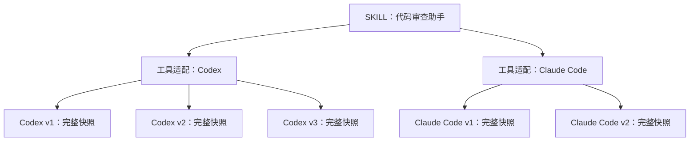

# SKILL center 多工具适配方案

> 本文为待评估的设计建议，不代表已经实现。基于当前 `master`、提交 `49ec134` 的代码静态核对；本轮只新增本文，不修改业务代码、数据库、现有功能文档或原型。本文中的新模型、字段、接口和交互均为拟议设计。

## 1. 结论与范围

推荐采用 **一个 SKILL → 多个工具适配 → 各自独立的历史版本 → 每版完整文件快照**。

- **SKILL** 表达共同用途和资源身份，例如“代码审查助手”，列表只占一行。
- **工具适配** 表达并存的使用对象，例如 Codex、Claude Code。界面不用“工具版本”命名，避免与工具自身的版本号及内容的历史版本混淆；代码建议称为 `SkillVariant`。
- **历史版本** 表达某个适配内容随时间的变化，例如 Codex v3、Claude Code v2。版本号仅在所属适配内有意义。

每个工具适配保存自己的完整 `SKILL.md` 或 ZIP，不采用公共正文加差异补丁，也不把两种适配塞进一个含多个入口的 ZIP。网站负责存储、浏览、对比和下载用户上传的适配内容，不负责转换工具格式或证明内容在对应工具中可运行。

推荐本期覆盖工具适配的创建、选择、独立上传/下载/历史，以及复用现有对比工作区进行跨工具内容对比。保留管理员私有访问、原包下载、容量限制和手动跨设备传递。自动同步、自动生成另一工具的内容、自动合并、分享、多用户权限、批量导出所有适配、工具软件版本兼容矩阵均不纳入本期。

最主要代价是同一段共同内容修改后，可能需要分别更新两个适配；完整快照也会增加数据库容量。对于目前“少数工具、内容细微差异、手动上传下载”的场景，这比引入继承和补丁合成更容易核对实际下载结果。

## 2. 当前实现的证据与影响

| 已核对的当前事实 | 依据 | 设计影响 |
| --- | --- | --- |
| `Skill` 只有 ID、时间和 `versions`，没有资源级名称；名称和简介保存在版本中 | `apps/api/prisma/schema.prisma` 的 `Skill`、`SkillVersion` | 多适配后必须明确共同展示信息的归属，不能继续任取一个最新版本作为整个 SKILL 的标题 |
| 版本号按整个 SKILL 递增，唯一约束为 `[skillId, number]` | 同上 | 必须改为按适配编号，不能只增加前端工具标签 |
| 列表仅取一个最新版本及总版本数，详情取整个资源的全部版本清单 | `apps/api/src/skills/skills.service.ts` 的 `list`、`detail` | 列表改为返回各适配摘要；历史按选中适配加载，避免所有历史一起增长 |
| 上传弹窗直接用 `target.versions[0]` 初始化名称、简介、格式和预期版本 | `apps/web/src/views/SkillCenter.tsx` 的 `UploadDialog` | 更新目标需要固定到具体适配；所有“最新”判断需要限定范围 |
| 保存使用父 SKILL 行锁、`expectedVersionId`、全局唯一 `requestId`，同内容和展示元信息不新增版本 | `skills.service.ts` 的 `save`；`views/skill-request-id.ts` | 并发基线、无变化检查和请求去重都需要包含适配归属 |
| 打开更新弹窗前刷新详情；保存时锁定草稿，校验期间允许重选文件 | `SkillCenter.tsx` 的 `load`、`UploadDialog` | 新设计必须保留这些行为，不能再次引入旧基线或异步草稿覆盖 |
| 单文件须名为 `SKILL.md`；ZIP 只接受唯一根入口或单层包裹目录入口；要求有效 `name`、`description` frontmatter | `apps/api/src/skills/skill-package.ts` | 不通过 ZIP 文件名、frontmatter 名称自动判断工具；继续一包对应一个适配的一版 |
| 原包是不可变字节，文件清单规范化且正文按需加载；对比按路径、摘要及文本进行 | `skill-package.ts`、`skills.service.ts`、`SkillCenter.tsx` | 多工具差异可复用现有文件和 DiffEditor 能力，无须另做补丁存储引擎 |
| 单文件支持纯文本/Markdown 切换；列表和详情已使用本地 `Select` | `SkillCenter.tsx`、`components/ui/select.tsx` | 新的工具选择沿用本地组件，不引入原生下拉框或新 UI 框架 |
| 所有 SKILL 接口要求管理员会话，下载路径已有 SKILL ID 和稳定版本 ID | `skills.controller.ts`、`docs/api/skills.md` | 保持权限和旧版本读取地址；不能因为新增适配而扩大可见范围 |

当前前端搜索、格式过滤、删除提示、详情标题、下载文件名也都依赖单条 `versions[0]`，需要随模型一起调整，不能只修改详情顶部。

现有定向测试覆盖包解析、路径和容量限制、清单哈希、无变化识别及请求 ID 生成；这些测试不能证明数据库迁移或多适配并发正确。本轮只阅读相关测试，没有执行测试、构建、编译、迁移或浏览器验证。

## 3. 候选方案与取舍

| 方案 | 核心思路 | 优点 | 缺点及适用边界 |
| --- | --- | --- | --- |
| 现有版本增加工具标签 | 所有历史继续放在一个版本序列，按工具筛选 | 数据调整少，适合只标记历史来源 | 最新版本、版本号、冲突基线仍混用；无法清晰表达并存内容，不推荐 |
| 多个独立 SKILL 加关联组 | 保持现有资源结构，另加聚合关系 | 有机会复用更多现有单资源逻辑，适合需要独立权限和生命周期的内容 | 列表聚合、删除、共同信息均有双重身份；本质仍是多个资源，不符合当前管理偏好 |
| **一个 SKILL 下独立工具适配** | 增加适配层，每个适配有完整快照和版本线 | 同一身份下同时保留多套内容；版本、下载和冲突范围明确；复用现有包解析与对比 | 需要修改 Schema、查询与上传目标；存在重复存储和人工维护成本；最适合当前场景 |
| 公共基线加工具补丁 | 存通用内容和差异，下载时合成 | 工具很多、内容高度重复时可能减少维护与存储 | 文件删除、重命名、ZIP 附件、补丁冲突和合成结果追溯更复杂；会改变原包保真方式，本期不采用 |

如果未来主要诉求变成“一处修改自动传播到大量工具”，且愿意采用生成后的下载包，应重新评估公共基线方案。当前需求没有要求这一能力，不以此提前引入合并或继承关系。

## 4. 概念、命名与建议规则

### 4.1 三层身份



Codex v3 不表示比 Claude Code v2 更先进，也不表示对应 Codex 软件的第三个版本。界面只在工具上下文清晰时缩写为 v3，消息、下载菜单和对比标题使用“Codex · v3”这样的完整名称。

### 4.2 工具标识与“未指定工具”

以下均为建议规则，需在实施前确认：

- 首期一个 SKILL 下每个工具只允许一个适配。初始工具选项为 Codex、Claude Code，以及用于旧数据或暂不分类的“未指定工具”；建议稳定标识分别为 `codex`、`claude-code`、`unspecified`。
- 不通过文件名、正文关键词或 frontmatter 自动判定工具。用户明确选择工具；工具标签不修改包内元信息，也不承诺工具兼容性。
- “未指定工具”表示尚未分类，**不等于适用于所有工具**。若实际需要“通用”适配，应经确认单独定义，不能把旧数据默认为通用。
- 两种工具使用完全相同的字节也可以各有一个适配；无变化检查只在同一适配内进行。
- 仅迁移或暂未分类的适配允许直接指定工具；目标工具已存在时拒绝修改，不自动合并两条历史。已分类内容的工具重命名、拆分和合并作为后续需求单独评估。

### 4.3 名称和简介的归属

建议为 `Skill` 增加共同展示名称和简介，形成稳定的列表标题；各 `SkillVersion` 现有 `name`、`description` 保留为当时的版本展示信息，不覆盖历史。

新建 SKILL 时由表单填写共同信息，可从首次上传内容预填，同时作为首版展示信息。给已有 SKILL 新建适配或追加版本时，表单明确区分“所属 SKILL（只读）”与“本次版本名称/简介”；版本展示信息可沿用当前行为，但修改它不重命名整个 SKILL。历史文件页可展示当时的版本名称，页面主标题仍为共同名称。

共同展示信息的独立编辑不是管理多个工具的前置能力，可后续补充；如果实施时要求保留从上传弹窗修改整个资源名称的体验，应另设明确入口和并发规则，不能让两个工具的上传争相改写共同标题。

## 5. 页面展示与操作流程

### 5.1 列表：一个 SKILL 一行

建议列为“名称/简介、工具适配、最近更新、操作”。移除脱离工具上下文的单一“当前版本、格式、文件数”列；这些信息放入适配摘要或详情，避免一行内出现多个含义不明的 v1。

示意：

```text
名称                 工具适配                                  最近更新     操作
代码审查助手         Codex · v3 · ZIP   Claude Code · v2 · MD    11-11        下载  删除
提交信息助手         未指定工具 · v4 · MD                      11-10        下载  删除
```

- 点击适配标签进入 `/skills/:id?variant=:variantId`；点击名称进入详情并明确显示选中的工具。
- 一个适配时，下载动作直接下载该适配最新的明确版本；多个适配时打开菜单，逐项显示“工具 · 版本 · 格式”，必须由用户选择，不静默取最近更新的工具。
- 名称搜索以共同名称和简介为主，并匹配各适配最新版本的展示名称与简介，兼顾旧名称检索。
- 保留格式筛选，可增加紧凑的工具筛选。两个筛选同时生效时，要求同一个适配满足工具和格式条件，不能用 Codex 的工具条件匹配 Claude Code 的 ZIP 格式。工具筛选建议按精确归属匹配，“未指定工具”不充当其他工具的匹配项。
- SKILL 更新时间取任意适配最近一次成功内容更新；适配自己的更新时间单独保留。分类动作如改变父资源排序，应在最终接口契约中明确。

### 5.2 详情：先选工具，再选历史版本

保留现有详情主体和“文件 / 版本历史 / 版本对比”页签。共同标题下方增加一行工具适配选择，与下方工作页签区分层级：

```text
代码审查助手                                      新增工具适配
工具适配  [Codex] [Claude Code]                    上传新版本  下载 Codex · v3
当前适配 Codex · 最新 v3 · 完整目录包
-----------------------------------------------------------------------
文件        版本历史 · 3        版本对比
版本 [v3]                  纯文本 / Markdown
文件列表                   内容预览
```

- 选项少时使用紧凑的分段按钮，空间不足时使用已有本地 `Select`；不增加左侧导航项，不把每个工具做成独立一级页面。
- 打开带适配参数的地址时按指定 ID 加载；无参数时按确定顺序选择第一个适配并在界面明确展示。该浏览默认值不等于替用户确定下载目标，不额外引入可配置默认适配字段。
- 切换适配后，保留当前工作页签，但重置版本选择为该适配最新，文件定位为 `SKILL.md`；历史数量、格式、下载目标、对比默认值一起更新。
- 沿用现有请求代次校验，较早请求不得覆盖新选择。加载失败不显示另一个工具缓存的正文，不允许用旧目标下载或提交；失效的 URL 参数显示提示并由用户重新选择。
- 查看历史版本时提示“正在查看 Codex · v1，最新为 Codex · v3”；“上传新版本”始终以该适配最新版本为基线，不以正在浏览的旧版为基线。
- “删除 SKILL”仍表示全部适配和全部历史，在确认弹窗明确列出适配数、总版本数。首期不增加单独删除适配或某个历史版本的能力，避免扩大删除语义。
- 已有纯文本/Markdown 切换、只读 Monaco、超大文件提示和管理员权限保持不变；内容区继续沿用 `app-main` 的宽度和边距。

### 5.3 创建、上传与跨设备下载

| 场景 | 建议流程与边界 |
| --- | --- |
| 新建 SKILL | 选择首个工具适配 → 上传 `SKILL.md`/ZIP 或手动输入 → 校验 → 确认共同名称/简介、版本信息 → 同事务创建 SKILL、适配、v1 |
| 已有 SKILL 新增工具 | 详情“新增工具适配” → 选择尚未存在的工具 → 上传或手动创建完整内容 → 同事务创建该适配及 v1；不从原适配自动拷贝历史 |
| 已有适配更新 | 先刷新该适配最新版本 → 弹窗固定 SKILL、适配及预期版本 → 校验完整内容并填写说明 → 显式提交创建下一版 |
| 列表上传遇到同名 | 提示前往已有 SKILL，可在那里选择新增工具适配或更新已有适配；继续保留明确另建资源的选择，不按名称自动归并 |
| 跨设备传递 | 设备 A 上传“Codex · v3” → 设备 B 选择该适配和版本并下载 → 用户自行备份、替换本地目录；网站不声称已自动安装或完成同步 |

新增工具适配与更新已有适配使用不同入口和保存语义，不在一次提交中根据内容猜测应该创建还是追加。已有工具选项禁用并提供“前往该适配”提示。

更新弹窗必须显示类似“代码审查助手 / Codex / 当前 v3”；保存时锁住工具、文件和元信息。文件检验期间仍允许重选文件并忽略旧检验结果。保存失败保留草稿；冲突后重新加载并展示该适配当前基线，由用户再次确认提交，不静默重试。

新建适配没有 `expectedVersionId`，其并发创建由工具唯一约束保护；追加版本必须提交该适配的最新版本 ID，不能使用同一 SKILL 下其他适配的版本作为基线。

### 5.4 单文件与 ZIP

- 每个适配可独立使用 MD 或 ZIP，例如 Codex 是目录包、Claude Code 是单文件；格式属于具体版本，不属于整个 SKILL，也不固定属于某个工具。
- MD 继续只接受 `SKILL.md`；工具标识在网站元数据中保存，不通过把入口改名为 `SKILL-codex.md` 实现区分。
- ZIP 仍是一版完整目录，缺失文件视为该版不存在，不与旧版或其他适配的目录合并。
- 同一适配从 ZIP 改为 MD，保留现有“新版本不再包含其他文件”的确认；Codex 从 ZIP 改为 MD 不影响 Claude Code 的任何文件和历史。
- 不接受包含 Codex、Claude Code 两套 `SKILL.md` 的聚合 ZIP 并自动拆分；继续使用唯一入口规则。批量导入如有需要另行设计。
- 下载指定版本的原始字节。MD 下载名继续为 `SKILL.md`，ZIP 建议为 `共同名称-工具标识-vN.zip`；后端响应头和前端 `link.download` 必须一致。网站标签不写入包内，也不额外套目录。
- 现有 10 MiB（含）上传、50 MiB 解压、500 个文件、1 MiB 文本预览及路径校验继续按每个上传包执行。新增适配数量不是绕过单包校验的方式。

## 6. 历史管理与对比

### 6.1 历史默认限定当前适配

工具选择为 Codex 时，“版本历史”只展示 Codex v3、v2、v1；不把 Claude Code 的新上传混入时间线。“与前一版比较”指同一适配的前一版；只有 v1 时该动作禁用。下载旧版不改变当前最新，也不回滚。

每行保留变更说明、时间、查看、对比和下载；无变化检查限定当前适配的最新完整内容、格式与展示元信息。另一个工具存在相同内容，不应阻止新建本适配的 v1。

### 6.2 同一工作区提供两种对比目的

默认进行“历史版本对比”，左右均为当前适配的上一版与最新版本。提供次要的“跨工具对比”切换，选择两个工具及各自一个具体版本，例如：

```text
对比范围 [历史版本 / 跨工具]
左侧 [Codex] [v3]         交换         右侧 [Claude Code] [v2]
```

跨工具对比使用“左侧/右侧”，不用“旧版/新版”，不把工具差异描述成升级，也不根据两个 v2 自动建立对应关系。默认预填当前工具最新与另一工具最新，选项标签展示工具和版本，用户可明确选择历史快照；无其他适配时禁用跨工具入口并说明原因。

比较对象始终是稳定版本 ID，工具选择只限定候选版本。比较期间追加新版本不自动替换左右对象；需要用户主动选中，避免查看中的基线变化。

### 6.3 复用现有差异算法

| 比较对象 | 展示方式 |
| --- | --- |
| MD 对 MD | 比较完整原始 `SKILL.md`，包含 frontmatter；Markdown 渲染仅用于阅读，不作为差异依据 |
| ZIP 对 ZIP | 规范化相对路径取并集，按文件摘要显示新增、删除、修改、未变；选中文本后使用现有 Monaco DiffEditor |
| MD 对 ZIP | MD 作为只有 `SKILL.md` 的清单参与比较；ZIP 的其他文件显示仅存在于对应一侧 |
| 二进制、非 UTF-8、超过预览上限 | 展示存在状态、大小和摘要，提供两侧明确版本的原包下载，不伪造文本差异 |
| 文件改名或不同工具使用不同路径 | 仍按删除与新增处理，不做语义重命名匹配 |

跨工具模式用“仅左侧 / 仅右侧 / 内容不同 / 相同”替代带升级含义的增删文案。它只展示内容差异，不提供合并、覆盖或自动生成另一个工具适配的操作。

## 7. 数据关系与一致性建议

### 7.1 推荐模型调整

以下为设计字段，不在本轮修改 Prisma Schema。

| 实体 | 推荐调整 | 约束与语义 |
| --- | --- | --- |
| `Skill` | 增加共同 `name`、`description`，增加 `variants` 关系 | 列表稳定身份；时间继续用于聚合排序；保留 ID |
| `SkillVariant`（新增） | `id`、`skillId`、`toolKey`、创建/更新时间、版本关系 | `[skillId, toolKey]` 唯一；版本创建前必须存在明确所属适配 |
| `SkillVersion` | 增加非空 `variantId`，保留 ID、`skillId`、已有快照字段 | 用 `[variantId, number]` 替换 `[skillId, number]`；每条适配独立递增；`requestId` 仍全局唯一 |
| `SkillFile` | 沿用当前结构 | 仍仅从属于版本，文件路径唯一和正文按需读取不变 |

保留版本上的 `skillId` 有利于复用旧读取地址及归属过滤，但会引入冗余关系。建议在数据库中通过包含 `skillId` 的适配复合引用确保 `SkillVersion.skillId` 与其适配的父 SKILL 相同，不能仅靠前端传对两个 ID。具体 Prisma 关系写法及级联路径需实施时验证。

不持久化可推导的“最新版本指针”或“SKILL 总版本号”，避免维护第二份状态。新增 `SkillVariant` 时必须和首版同事务成功，不保留空适配。

### 7.2 保存与并发

- 最小改动可继续使用现有父 SKILL 行锁，**仅将最新版本查询、编号和无变化判断改为按 `variantId` 过滤**。Codex 保存与 Claude Code 保存可能短暂串行，但不会因为另一个适配更新就返回预期版本冲突。
- 创建适配、为“未指定工具”归类、追加版本采用一致的父资源锁顺序，并依靠唯一约束兜底。现阶段不必为降低少量锁等待引入更复杂的分适配锁。
- `expectedVersionId` 必须属于目标适配且为它的最新版本；其他适配的版本 ID 不能通过验证。
- 请求 ID 和载荷指纹必须绑定保存操作类型、SKILL/适配归属及内容。切换适配或改变提交参数生成新请求 ID，相同请求重试返回同一结果；服务端不能只检查内容相同就把另一个适配的结果当作成功。
- 新建资源、新建适配和追加版本应分别约束重放语义；实现时检查事务内外与异常补查三个去重分支，不能仅修改第一处 `requestId` 检查。若现有快照字段不能可靠区分操作类型，再增加最小的持久化请求语义字段，不预先引入独立工作流系统。
- 删除整个 SKILL 继续级联删除所有适配、版本和文件。迁移和实现时验证删除与并发保存不会留下孤立快照。

## 8. 接口与前端调整建议

### 8.1 拟议 API

统一前缀仍为 `/api`，以下省略此前缀。所有新接口继续管理员会话保护和 `private, no-store`。

| 方法与路径 | 建议契约 |
| --- | --- |
| `GET /skills` | 返回共同信息和每个适配的工具、最新版本摘要、版本数；不返回各适配完整历史、正文或原包 |
| `GET /skills/:id` | 返回共同信息与适配摘要，供切换工具；新前端不再依赖根级 `versions[0]` |
| `GET /skills/:id/variants/:variantId`（新增） | 返回该适配的历史及文件清单；沿用当前详情不带正文/原包的边界 |
| `POST /skills/inspect` | 沿用当前只校验和解析包的能力，不猜测工具、不创建适配 |
| `POST /skills` | 现有 multipart 增加 `toolKey`；同事务创建共同资源、首个适配和首版；旧调用未指定工具时兼容为 `unspecified` |
| `POST /skills/:id/variants`（新增） | 显式 `toolKey`、完整文件、版本展示信息、说明和请求 ID；创建该适配 v1，工具重复时返回冲突 |
| `POST /skills/:id/versions` | 增加明确的 `variantId`，保留 `expectedVersionId`；对该适配追加版本，不新增另一种含糊的自动分流接口 |
| `PATCH /skills/:id/variants/:variantId`（新增、受限） | 仅用于“未指定工具”明确归类，包含预期原工具标识；目标已存在或已被其他请求归类则冲突，不修改任何快照 |
| 现有 `GET /skills/:id/versions/:versionId/files/:fileId`、`.../download` | 保留地址与稳定版本 ID，校验版本属于指定 SKILL；若请求附带适配上下文也要核对归属 |
| `DELETE /skills/:id` | 继续删除整个资源，范围包含新增的适配层 |

兼容原则：旧追加请求没有 `variantId` 时，只有资源恰好一个适配才可明确解析目标；多个适配时返回需要显式选择目标的错误，不能静默写入默认工具。既有 GET 响应若需要过渡兼容，可在单适配资源保留原 `versions` 投影；多适配不能伪造一个全局最新版本。实际是否存在其他调用方需实施前确认，再决定兼容投影保留多久。

当前 Multer 允许最多 6 个文本字段。现有追加为 `name`、`description`、`note`、`requestId`、`expectedVersionId` 五项，加 `variantId` 后正好六项；创建新增 `toolKey` 后为五项。按此最小契约不必扩大字段数限制；如果再加其他表单字段，必须同步核对，避免上传在 DTO 前被拒绝。10 MiB 文件上限与 Docker 的 11 MiB 请求体额度保持原有契约。

列表摘要尽量只带格式、文件数等必要信息，不默认携带每个适配最新版本的全部文件清单。跨工具对比按需加载两条适配的历史/清单和选中文本，避免重新引入详情一次返回所有正文的问题。规模需要时再做历史分页，本期不引入新的搜索或存储服务。

### 8.2 前端责任范围

- `apps/web/src/types/skill.ts`：区分共同 SKILL、适配摘要、适配详情、版本和保存目标的类型；版本增加所属适配信息。
- `apps/web/src/api/skills.ts`：增加适配详情、创建和归类请求；追加版本携带适配；下载文件名处理与后端一致。
- `apps/web/src/views/SkillCenter.tsx`：列表摘要和下载菜单、工具选择、适配内版本选择、历史数量、完整上下文提示、双工具对比和删除范围。
- `UploadDialog`：显式区分新建资源、新建适配、追加版本；保存目标和预期版本在弹窗打开时固定。可以按职责做必要拆分，但不借机重构其他页面。
- `apps/web/src/views/skill-request-id.ts`：保留相同载荷复用 ID 的函数；调用方载荷补充操作和适配归属，补相应定向测试。
- 路由仍使用现有 `/skills`、`/skills/:id`；适配选择使用查询参数，不新增侧栏模块。
- 后端对应修改 Controller/DTO/Service、Prisma Schema 和迁移；实施时同步更新 `docs/api/skills.md`、Feature 文档及架构边界。本轮不提前把拟议能力写入当前功能说明。

## 9. 旧数据兼容与实施顺序

### 9.1 数据迁移建议

1. 部署前备份数据库并验证可恢复。读取现有数据和约束，确认是否存在无版本 SKILL 或其他异常，不假定线上与本地完全一致。
2. 增加共同名称/简介、适配表和可回填的版本适配字段；每个已有 SKILL 建立一个 `unspecified` 适配。
3. 将该资源全部历史关联到这个适配，保留所有 SKILL ID、版本 ID、文件 ID、版本编号、时间、说明、哈希、请求 ID、文件正文和原包字节。
4. 共同名称/简介取该资源原最新版本的展示信息，只作为本次迁移的初值；不回写历史。适配创建时间取原资源时间，更新时间取原最新内容时间，并避免无意义地刷新所有资源排序。
5. 检查关联无遗漏、每个适配至少一版、工具唯一、父子归属一致后，将版本适配字段设为非空并替换编号唯一约束。无版本资源没有可取的名称，需明确处理后再完成约束，不能静默编造内容。
6. 部署后提示“工具尚未指定”，管理员确认历史全部属于 Codex 时可一次归类为 Codex，原版本号和读取地址不变。再为 Claude Code 新建适配，从它自己的 v1 开始。

如果旧历史已经混用了两个工具，不执行自动拆分：保留在未指定适配，管理员可分别上传各工具的当前包建立两条新历史；如要求精确拆分旧历史，需要单独评估显式映射、编号和引用迁移，不混入本次自动迁移。

### 9.2 分步落地

1. 先确认本文末尾的产品规则及真实调用方；核对迁移样本和下载保真基线。
2. 完成模型、约束、回填和后端目标隔离；保持旧只读版本 URL。
3. 接入前端列表、工具选择、创建/追加、历史和下载，消除 `versions[0]` 代表全局最新的假设。
4. 复用现有对比工作区增加双工具选择，并保留 Markdown 阅读、窄屏和加载失败行为。
5. 在独立测试环境验证迁移和核心流程，取得部署授权后执行正式迁移。用户未批准前不运行构建、编译或迁移。

一旦不同适配产生重复编号（例如各有 v1），旧代码的 `[skillId, number]` 假设便不再成立，不能仅回退前端或直接运行旧版服务。上线前应确定扩展/回填/收紧约束的部署顺序；回退通常需要停止写入并使用经验证的数据库恢复或专用反向迁移，不能承诺无损一键回滚。

## 10. 建议验收与未验证事项

本节是未来实施的验证要求，不表示本轮已经运行。

- 一个 SKILL 同时有 Codex v2、Claude Code v1，列表仍只一行；工具、历史数量、格式和下载目标不混用。
- 两工具上传相同包均可各自创建 v1；同工具内容及展示信息未变时不增加版本；单纯改变 ZIP 压缩形式仍视为无内容变化。
- 设备 A 和 B 更新同一个适配时，后者旧基线冲突；刷新后展示新基线且要求再次提交。更新不同适配时各自追加成功，不产生跨适配的陈旧版本错误。
- 两设备同时创建同工具只有一个适配；请求超时重试不重复创建；相同请求 ID 被用于其他操作、工具或内容时不能误返回成功。
- 检验期间重选文件仍可用；保存期间锁住草稿；切换工具的旧请求不能覆盖新工具的正文或历史。加载失败不允许提交旧适配。
- MD/ZIP、ZIP 到 MD 的确认和跨适配隔离正确；原包摘要迁移前后及指定版本下载前后一致。
- 相同工具历史对比、跨工具不同编号对比、MD/ZIP 混合对比、二进制及大文本降级正确；对比标题不误称升级。
- 旧版本和文件 URL 保持可读；旧追加请求只在单适配资源可自动解析目标；多适配时明确拒绝含糊目标。
- 删除资源包含所有适配与快照，匿名访问所有新读写和下载路径仍被拒绝。
- 核对 1440px、超宽屏和窄屏布局；长工具名、加载/空/错误状态、键盘选择和弹窗焦点；没有引入原生工具下拉框或新的 UI 框架。

本轮证据来自当前代码和文档，没有运行真实 API、浏览器、数据库迁移、测试、构建或编译。尚未确认实际数据库的数据规模、是否存在混合工具历史、是否有仓库外 API 调用方，以及真实工具包在不同工具中的运行兼容性。上述缺口影响实施细节和部署验证，不影响将工具适配与时间版本分开的核心建议。

## 11. 实施前待确认事项

| 待确认事项 | 当前建议 | 对实施的影响 |
| --- | --- | --- |
| 同一工具是否需要多个并存配置，如个人/团队或不同模型 | 本期每个工具一个适配 | 若需要多个配置，应将工具标识与适配名称分开，不能使用 `[skillId, toolKey]` 唯一约束 |
| 是否需要显式“通用”适配或更多工具 | 先支持 Codex、Claude Code、未指定工具；不宣称后者通用 | 决定工具选项和筛选语义；自定义工具编辑器不作为前置功能 |
| 老数据实际属于哪些工具，是否有混合历史 | 全部迁入未指定工具，用户确认后归类 | 决定是否需要额外的人工历史拆分方案 |
| 是否接受相同内容分别维护和存储 | 本期接受完整独立快照 | 若要求一处修改传播到各工具，应重评公共基线方案 |
| 是否需要单独删除工具适配 | 本期仍只支持删除整个 SKILL | 如需加入，另行确定最后一个适配、引用和确认弹窗规则 |
| 是否需要同时比较不同工具的内容 | 建议复用现有对比工作区本期支持 | 可在交付排期中后移，不影响独立适配和历史模型 |
| 是否需要编辑共同展示信息 | 非本期前置能力，避免从某工具上传时隐式修改 | 如纳入，新增明确的共同资料编辑入口及并发契约 |

上述为可供评估的建议，不将待确认规则视为现有事实，也不构成本轮业务实现授权。
